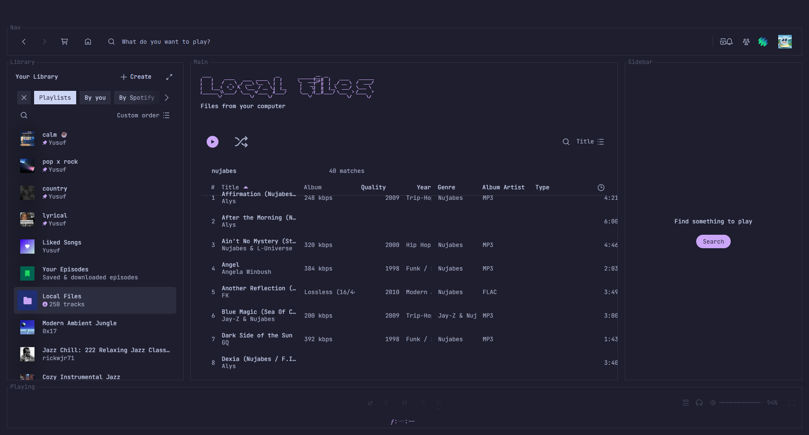

# Local Files+

<!-- site:skip-start -->
**Documentation:** https://spicetify.yusufaf.dev/local-files-plus/
<!-- site:skip-end -->

A [Spicetify](https://spicetify.app/) extension that reads the real tag metadata off
your local audio files — artist, album artist, year, genre, bitrate/quality, and more
— and adds it back into Spotify's **Local Files** page as sortable, filterable
columns.

Spotify's own Local Files view only shows a handful of columns, and its column picker
offers exactly two toggles: Album and Duration. Everything else — album artist, year,
genre, real bitrate, file type, folder — already lives in your files' tags. Local
Files+ reads it and puts it back.



## Features

- **Extra columns**: Quality (bitrate/lossless), Year, Genre, Album Artist, Artist,
  Type, Size, Date Modified, # (track number), BPM, Folder — toggle any of them on/off
  from Spotify's own "Change visible columns" popover.
- **Quality**: lossy files show an average bitrate worked out from file size and
  length (embedded cover art counts toward the size); FLAC, ALAC and WAV show
  Lossless, with bit depth and sample rate for FLAC.
- **Missing-tag marker** — a small ⚠ next to any track missing album, artist, or
  track number, so you can spot what still needs tagging.
- **Sort** by any extra column — click its header.
- **Filter**, e.g. `flac year:2019 genre:jazz`, `lossless`, `bitrate:>256` (256 or
  more), `missing:album`, `folder:Nujabes`.

## How it works

Local Files+ asks for one-time read access to your music folder via the browser's
[File System Access API](https://developer.mozilla.org/en-US/docs/Web/API/File_System_API)
— no install, no background process, nothing leaves your machine. It walks the folder,
parses ID3v2 (MP3), Vorbis comments (FLAC), and MP4 atoms (M4A) directly from the file
bytes, caches the result, and matches each parsed file back to the track Spotify
already knows about: by path where Spotify exposes one, otherwise by title tag or file
name.

## Install

Requires [Spicetify](https://spicetify.app/docs/getting-started), installed and applied at least once. The Marketplace route also needs the [Spicetify Marketplace](https://spicetify.app/docs/customization/marketplace) custom app.

### From Spicetify Marketplace

1. In Spotify, open **Marketplace** (the shopping-cart icon at the top left) and stay on the **Extensions** tab.
2. Search for `Local Files+`. If it doesn't show up, click **Load more** (» at the bottom of the list) until it does. Marketplace loads extensions in batches and only searches the ones it has loaded.
3. Hover the **Local Files+** card, click its download button, then click **Reload now**.

### Manually

1. Download [`local-files-plus.js`](https://raw.githubusercontent.com/yusufaf/spicetify-local-files-plus/main/local-files-plus.js) (right-click → **Save link as…**) into your Spicetify `Extensions` folder:
   - Windows: `%APPDATA%\spicetify\Extensions`
   - macOS / Linux: `~/.config/spicetify/Extensions`
2. Enable it and apply:

   ```bash
   spicetify config extensions local-files-plus.js
   spicetify apply
   ```

## Setup

Open **Local Files+** settings from the profile menu, or from the **Local Files+ settings**
button above the Local Files track list, then **Choose music folder** and pick the same
folder Spotify uses for Local Files. (On Spotify 1.3.5 the profile-menu entry doesn't
render, so use the button.) The first scan parses every audio file in it;
later scans only re-parse files that changed.

## Supported formats

Tags are parsed from `.mp3` (ID3v2.2/2.3/2.4, falling back to ID3v1), `.flac`
(Vorbis comments + STREAMINFO for sample rate/bit depth), and `.m4a`/`.mp4` (MP4
atoms; ALAC is detected as lossless). `.aac` tags are read when the file carries an
ID3 tag. `.ogg`, `.oga`, `.opus`, `.wav` and `.wma` are indexed (size, type) but their
tags aren't read yet.

## Development

No build step — `local-files-plus.js` is the whole extension.

```bash
pnpm test          # syntax check, then the parser and matching tests in test/
pnpm install        # installs husky hooks
```

The tag parsers are pure functions (`ArrayBuffer` in, plain objects out) and run
identically under Node, so they're testable without Spotify — see the
`module.exports` guard at the bottom of the file.

## License

MIT
